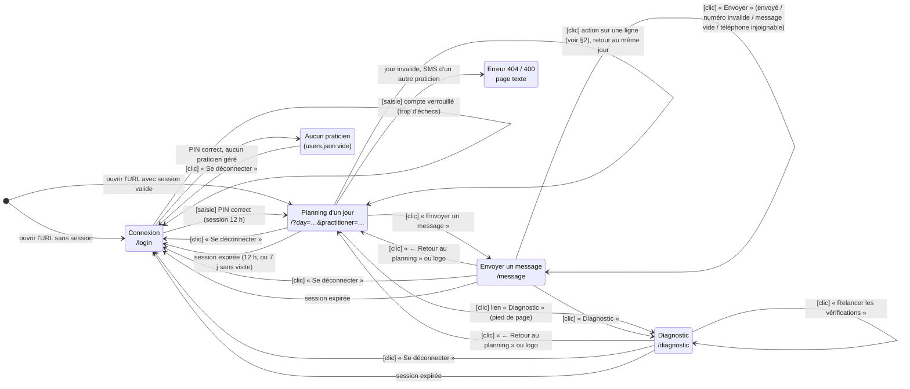
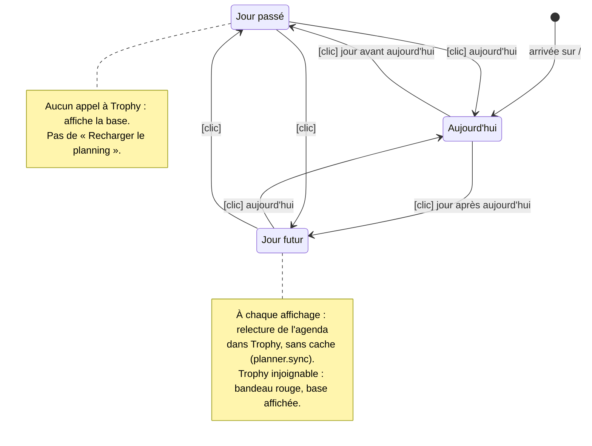
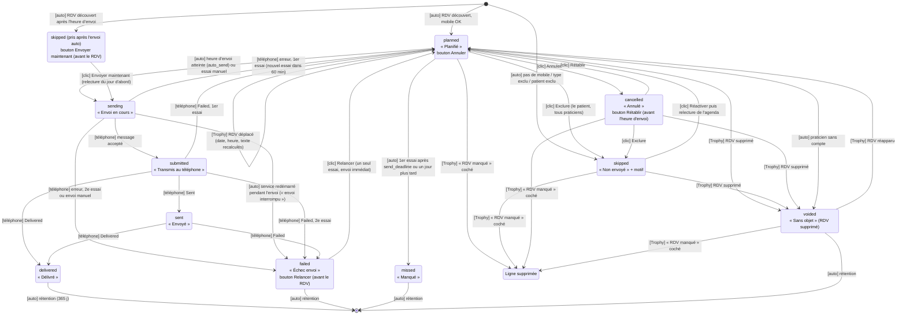
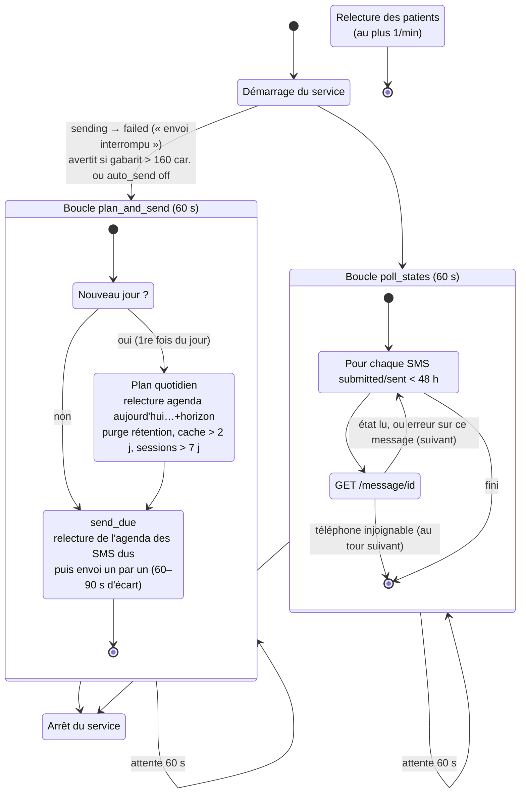
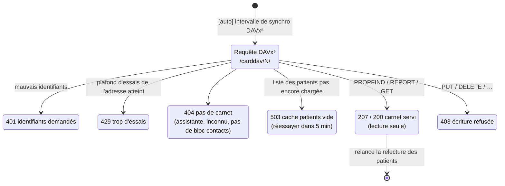

# MediRappel — machine à états

Trois vues : les **pages** (ce que voit l'utilisateur), la **vie d'un SMS de rappel** (une ligne du
tableau), et les **tâches de fond** invisibles. Tiré du code de la version 0.1.6.

Légende des transitions : `[clic]` bouton ou lien, `[saisie]` formulaire, `[auto]` tâche de fond,
`[Trophy]` changement fait dans le logiciel du cabinet, `[téléphone]` réponse de SMSGate.

---

## 1. Pages et navigation

### Variantes de la page « Planning d'un jour »

Bandeaux possibles en haut du jour :

| Bandeau | Condition |
|---|---|
| Envoi automatique désactivé | `auto_send: false`, jour non passé |
| Mode simulation | `smsgate.simulation: true` |
| Mode essai | `smsgate.test_number` renseigné |
| Logiciel du cabinet injoignable | relecture Trophy en échec |
| Planning à venir rechargé | après « Recharger le planning » réussi |

---

## 2. Vie d'un SMS de rappel (une ligne du tableau)

Une ligne = un rendez-vous Trophy (`reminder`). Le bouton en fin de ligne dépend de l'état.

Remarques :

- **Verrouillés** (jamais modifiés par une relecture de l'agenda) : `sending`, `submitted`, `sent`,
  `delivered`, `failed`, `missed`, et toute ligne déjà essayée une fois.
- **« Exclure » / « Réactiver »** sont présents sur toutes les lignes (colonne après le nom) : ils
  portent sur le patient, pas sur le SMS. Un SMS déjà parti n'est pas touché.
- **`auto_send: false`** : `planned` attend comme pendant un arrêt du service ; seuls les essais
  manuels (Relancer, Envoyer maintenant) partent. Après `send_deadline` : `missed`.
- **Mode simulation** : `submitted` passe à `delivered` au tour suivant, sans téléphone.
- Le suivi `submitted`/`sent` s'arrête 48 h après l'envoi : la ligne garde son dernier statut.

---

## 3. Tâches de fond (invisibles)

Un seul processus. Deux boucles asyncio tournent toutes les **60 s**, plus des tâches déclenchées.

| Tâche | Déclencheur | Effet |
|---|---|---|
| Plan quotidien | 1er tour de boucle de chaque jour (minuit, ou au démarrage) | relit l'agenda de chaque praticien géré pour aujourd'hui … aujourd'hui + N + marge ; purge SMS > `retention_days`, cache Trophy > 2 j, sessions > 7 j |
| Envoi des SMS dus | chaque minute | relit l'agenda des jours concernés, passe en `missed` ce qui est trop tard, envoie le reste (temporisé) |
| Suivi des statuts | chaque minute | interroge SMSGate pour chaque SMS transmis depuis moins de 48 h |
| Relecture des patients | ouverture de `/message` ou requête CardDAV, au plus 1/min | 1re page de `/patients` fusionnée ; chargement complet si le cache a plus d'un jour |
| Cache Trophy | à la demande | praticiens et calendrier 24 h, agenda 15 min (les pages et l'ordonnanceur relisent l'agenda sans cache) |

---

## 4. Acteur externe : le téléphone (CardDAV, DAVx⁵)

Pas une page : le téléphone SMSGate synchronise les carnets de contacts.

